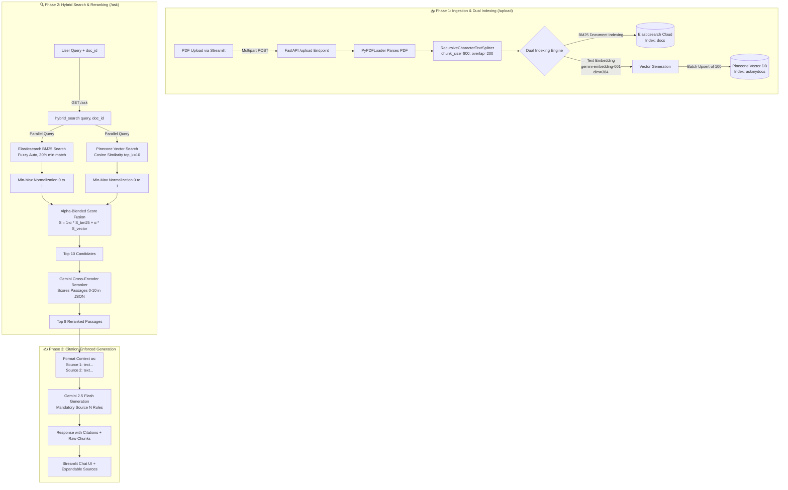

# 📄 AskMyDocs-RAG: End-to-End Technical Architecture & Walkthrough

> **AskMyDocs-RAG** is a production-grade, domain-specific Retrieval-Augmented Generation (RAG) system engineered for high accuracy, low hallucination, and strict citation enforcement. It combines **BM25 keyword search (Elasticsearch)** with **semantic vector search (Pinecone)**, applies an **LLM-based Cross-Encoder Reranker**, and leverages **Google Gemini 2.5 Flash** to generate answers anchored precisely to source documents.

---

## 🏗️ 1. Executive Summary & Core Design Philosophy

Traditional RAG systems often suffer from three critical bottlenecks:
1. **The Keyword vs. Semantic Gap**: Keyword-only search misses synonyms and conceptual queries, while vector-only search misses exact part numbers, acronyms, or specific names.
2. **Hallucination & Lack of Verifiability**: LLMs frequently weave external knowledge into answers without clear attribution, making it impossible for users to trust high-stakes outputs (e.g., legal or financial documents).
3. **Resource & Memory Constraints in Production**: Standard cross-encoder rerankers (`PyTorch` + `sentence-transformers`) require heavy RAM (~1GB+), causing crashes on budget-friendly cloud instances like Render's 512MB free tier.

**AskMyDocs-RAG** solves these challenges through:
* **Hybrid Alpha-Blended Retrieval**: Combining fuzzy BM25 keyword matching (`Multi-Match` with `AUTO` fuzziness) and 384-dimensional semantic embeddings (`gemini-embedding-001`).
* **Zero-RAM Cross-Encoder Reranking**: Offloading passage scoring ($0\text{--}10$) to `gemini-2.5-flash` via structured JSON prompts.
* **Strict Citation Enforcement**: Numbering top retrieved chunks (`[Source 1]`, `[Source 2]`, etc.) and enforcing exact source attribution in prompt rules, paired with an interactive frontend source viewer.

---

## 🔄 2. Complete End-to-End Architecture & Data Flow



---

## 🔬 3. Detailed Walkthrough of the RAG Pipeline

### Phase 1: Document Upload & Dual Indexing (`POST /upload`)

When a user drops a PDF into the Streamlit UI, the following exact lifecycle unfolds:

1. **Temporary File Handling & Loading**:
   In [backend/main.py:45-53](file:///Users/kartikkhanna/Documents/Work/Skills/Development/AskMyDocs-RAG/backend/main.py#L45-L53), the uploaded PDF stream is saved to a temporary local file (`NamedTemporaryFile`), parsed page-by-page using LangChain's `PyPDFLoader`, and then deleted from disk:
   ```python
   with tempfile.NamedTemporaryFile(delete=False, suffix=".pdf") as tmp:
       tmp.write(file.file.read())
       tmp_path = tmp.name

   loader = PyPDFLoader(tmp_path)
   documents = loader.load()
   os.remove(tmp_path)
   ```

2. **Context-Preserving Chunking**:
   The document is split into overlapping chunks using `RecursiveCharacterTextSplitter` ([backend/main.py:58-64](file:///Users/kartikkhanna/Documents/Work/Skills/Development/AskMyDocs-RAG/backend/main.py#L58-L64)):
   ```python
   splitter = RecursiveCharacterTextSplitter(
       chunk_size=800,
       chunk_overlap=200
   )
   chunks = splitter.split_documents(documents)
   ```
   > [!NOTE]
   > **Why `800` / `200`?** A chunk size of `800` characters gives the LLM enough surrounding context (roughly 150-200 words) to understand complete thoughts, while a `200` character overlap ensures that entities or sentences split across chunk boundaries aren't lost during search.

3. **Dual Indexing Engine (`index_documents`)**:
   In [backend/retrieve.py:253-284](file:///Users/kartikkhanna/Documents/Work/Skills/Development/AskMyDocs-RAG/backend/retrieve.py#L253-L284), every chunk is simultaneously indexed into both search systems:
   * **Elasticsearch (BM25 Index)**: Each chunk is indexed into the `docs` index with fields `text` and `doc_id`. This allows fast keyword filtering specific to the user's document ID.
   * **Gemini Embeddings (`gemini-embedding-001`)**: The chunk text is converted into a **384-dimensional dense vector** ([backend/retrieve.py:31-48](file:///Users/kartikkhanna/Documents/Work/Skills/Development/AskMyDocs-RAG/backend/retrieve.py#L31-L48)):
     ```python
     result = gemini_client.models.embed_content(
         model="gemini-embedding-001",
         contents=text,
         config={"output_dimensionality": 384}
     )
     ```
     > [!TIP]
     > **Matryoshka Representation Learning (MRL)**: Google's `gemini-embedding-001` supports configurable output dimensions via MRL. By choosing `dim=384` instead of the full `768`, the system halves Pinecone storage and bandwidth requirements while retaining ~99% of semantic retrieval accuracy!
   * **Batch Pinecone Upsert**: Vectors are batched in groups of `100` to prevent HTTP payload size timeouts during ingestion ([backend/retrieve.py:279-282](file:///Users/kartikkhanna/Documents/Work/Skills/Development/AskMyDocs-RAG/backend/retrieve.py#L279-L282)).

---

### Phase 2: Hybrid Search & Alpha-Blended Score Fusion (`hybrid_search`)

When a user asks a question, [backend/retrieve.py:143-184](file:///Users/kartikkhanna/Documents/Work/Skills/Development/AskMyDocs-RAG/backend/retrieve.py#L143-L184) executes a parallel retrieval and score fusion process:

#### 1. BM25 Keyword Search (`bm25_search`)
Elasticsearch queries the `docs` index with a `bool` query ([backend/retrieve.py:54-88](file:///Users/kartikkhanna/Documents/Work/Skills/Development/AskMyDocs-RAG/backend/retrieve.py#L54-L88)):
* **Filter**: Strictly enforces `doc_id == user_doc_id` so users never see chunks from other uploaded documents.
* **Multi-Match**: Searches `["text"]` with `fuzziness: "AUTO"` (handles typos/misspellings gracefully) and `minimum_should_match: "30%"` (requires at least 30% of query tokens to match).

#### 2. Vector Semantic Search (`vector_search`)
The query text is embedded into a 384-dim vector (`gemini_embedding(query)`) and searched against Pinecone using `cosine similarity`, filtered by `doc_id` ([backend/retrieve.py:94-113](file:///Users/kartikkhanna/Documents/Work/Skills/Development/AskMyDocs-RAG/backend/retrieve.py#L94-L113)).

#### 3. Min-Max Score Normalization (`normalize_scores`)
Because BM25 scores can range from `0` to `50+` while Cosine Similarity scores range from `-1.0` to `1.0`, raw scores cannot be added directly. `normalize_scores` ([backend/retrieve.py:119-137](file:///Users/kartikkhanna/Documents/Work/Skills/Development/AskMyDocs-RAG/backend/retrieve.py#L119-L137)) scales both sets of scores to the $[0, 1]$ interval:

$$\text{Score}_{\text{norm}} = \frac{S - S_{\min}}{S_{\max} - S_{\min}}$$

If all scores are identical ($S_{\max} == S_{\min}$), they are safely assigned `1.0` to prevent division by zero.

#### 4. Alpha-Blended Fusion
The normalized scores are linearly combined across candidate chunks ([backend/retrieve.py:166-178](file:///Users/kartikkhanna/Documents/Work/Skills/Development/AskMyDocs-RAG/backend/retrieve.py#L166-L178)):

$$\text{Score}_{\text{final}} = (1 - \alpha) \cdot \text{Score}_{\text{BM25}} + \alpha \cdot \text{Score}_{\text{Vector}}$$

With `alpha = 0.5`, keyword matches and conceptual semantic matches contribute equally to candidate ranking. The top 10 unique candidates are selected for reranking.

---

### Phase 3: Zero-Memory Cross-Encoder Reranking (`rerank_with_gemini`)

In traditional RAG pipelines, Bi-Encoders (like Pinecone cosine similarity) are fast but only compute similarity between independent query and document vectors. Cross-Encoders evaluate the **query and passage together**, detecting subtle logical connections.

However, running local Cross-Encoders (`torch` models) causes out-of-memory errors on small web hosts. AskMyDocs solves this by using `gemini-2.5-flash` as a **Zero-Memory Cross-Encoder** ([backend/retrieve.py:191-246](file:///Users/kartikkhanna/Documents/Work/Skills/Development/AskMyDocs-RAG/backend/retrieve.py#L191-L246)):

```python
prompt = f"""You are a relevance scoring system. Score each passage for how relevant it is to the query.

Query: {query}

Passages:
{passage_list}

Return ONLY a JSON array of objects with "index" and "score" (0-10, where 10 = perfectly relevant).
Example: [{{"index": 0, "score": 8}}, {{"index": 1, "score": 2}}]"""
```

The system parses the structured JSON output, reorders the 10 candidates by their exact Gemini relevance score, and passes the **top 8 reranked passages** to the generation stage.

---

### Phase 4: Citation-Enforced Answer Generation (`generate_answer`)

In [backend/generate.py:10-47](file:///Users/kartikkhanna/Documents/Work/Skills/Development/AskMyDocs-RAG/backend/generate.py#L10-L47), the top 8 passages are formatted with clear bracketed labels (`[Source 1]`, `[Source 2]`, ... `[Source 8]`):

```python
context_parts = []
for i, doc in enumerate(docs[:8]):
    context_parts.append(f"[Source {i+1}]: {doc}")
context = "\n\n---\n\n".join(context_parts)
```

The system sends this context alongside the user's question to `gemini-2.5-flash` with strict **Anti-Hallucination and Citation Rules**:
1. *You MUST cite your sources using `[Source N]` notation after each claim.*
2. *If multiple sources support the same point, cite all of them: `[Source 1][Source 3]`.*
3. *Do NOT make up or infer information that isn't explicitly in the sources.*
4. *Only say "not found in the document" if you have thoroughly checked every source.*

---

### Phase 5: Streamlit Interactive Chat UI (`frontend/app.py`)

The frontend ([frontend/app.py](file:///Users/kartikkhanna/Documents/Work/Skills/Development/AskMyDocs-RAG/frontend/app.py)) provides a responsive, multi-document ChatGPT-style interface:

* **Per-Document State Isolation**: Session states `st.session_state.docs` (`{filename: doc_id}`) and `st.session_state.messages` (`{filename: [msg_history]}`) ensure that switching between multiple uploaded PDFs instantly loads that exact document's specific chat history without cross-contamination ([frontend/app.py:66-88](file:///Users/kartikkhanna/Documents/Work/Skills/Development/AskMyDocs-RAG/frontend/app.py#L66-L88)).
* **Interactive Source Verification**: Whenever the assistant generates an answer with `[Source N]` citations, the frontend renders an expandable `📚 Sources` box containing the exact raw text of each retrieved chunk ([frontend/app.py:122-128](file:///Users/kartikkhanna/Documents/Work/Skills/Development/AskMyDocs-RAG/frontend/app.py#L122-L128)):
  ```python
  if docs:
      with st.expander("📚 Sources"):
          for i, d in enumerate(docs):
              st.markdown(f"**[Source {i+1}]**")
              st.caption(d[:500])
              st.divider()
  ```
  Users can immediately click to verify whether `[Source 1]` in the text matches the raw chunk!

---

## 📂 4. Comprehensive File & Component Directory

| File Path | Role & Primary Responsibilities |
| :--- | :--- |
| [backend/main.py](file:///Users/kartikkhanna/Documents/Work/Skills/Development/AskMyDocs-RAG/backend/main.py) | **FastAPI Application Core**: Sets up CORS middleware (`["*"]`), exposes `GET /` health check, `POST /upload` (PDF upload, `PyPDFLoader`, `RecursiveCharacterTextSplitter(800, 200)`), and `POST /ask` orchestration. Includes graceful error handling for LLM quota issues (`LLM quota exceeded. Showing raw context.`). |
| [backend/retrieve.py](file:///Users/kartikkhanna/Documents/Work/Skills/Development/AskMyDocs-RAG/backend/retrieve.py) | **Retrieval & Indexing Engine**: Manages connections to Elasticsearch, Pinecone, and Gemini API. Implements `gemini_embedding(dim=384)`, `bm25_search`, `vector_search`, `normalize_scores`, `hybrid_search(alpha=0.5)`, `rerank_with_gemini`, and batch vector upserts via `index_documents`. |
| [backend/generate.py](file:///Users/kartikkhanna/Documents/Work/Skills/Development/AskMyDocs-RAG/backend/generate.py) | **Citation-Enforced LLM Generation**: Takes the top 8 reranked passages, numbers them `[Source 1]` through `[Source 8]`, and prompts `gemini-2.5-flash` with strict grounding instructions. |
| [backend/config.py](file:///Users/kartikkhanna/Documents/Work/Skills/Development/AskMyDocs-RAG/backend/config.py) | **Environment Configuration**: Safely loads environment secrets via `os.getenv` (`ELASTIC_CLOUD_ID`, `ELASTIC_API_KEY`, `PINECONE_API_KEY`, `PINECONE_INDEX`, `GEMINI_API_KEY`). |
| [backend/ingest.py](file:///Users/kartikkhanna/Documents/Work/Skills/Development/AskMyDocs-RAG/backend/ingest.py) | *Standalone utility/legacy module* for loading and splitting PDFs with `chunk_size=500, chunk_overlap=50`. (Note: Production endpoints in `main.py` directly use the upgraded `800/200` chunking parameters). |
| [frontend/app.py](file:///Users/kartikkhanna/Documents/Work/Skills/Development/AskMyDocs-RAG/frontend/app.py) | **Streamlit Chat Frontend**: Manages document upload, multi-document selection, isolated chat message history, expandable citation source viewers, and history/document reset controls. |
| [render.yaml](file:///Users/kartikkhanna/Documents/Work/Skills/Development/AskMyDocs-RAG/render.yaml) | **Render Infrastructure as Code**: Defines the web service deployment specifications (`python 3.11.0`, `uvicorn main:app --host 0.0.0.0 --port $PORT`) and environment variable sync keys. |
| [requirements.txt](file:///Users/kartikkhanna/Documents/Work/Skills/Development/AskMyDocs-RAG/requirements.txt) | **Dependencies**: Core packages including `fastapi`, `uvicorn`, `elasticsearch`, `pinecone`, `langchain-community`, `pypdf`, `google-genai`, and `python-dotenv`. |

---

## ⚙️ 5. Deployment & Configuration Architecture

### Local Development Setup
1. **Virtual Environment & Dependencies**:
   ```bash
   python3 -m venv venv
   source venv/bin/activate
   pip install -r requirements.txt
   ```
2. **Environment Variables (`.env`)**:
   ```ini
   ELASTIC_CLOUD_ID=your_cloud_id
   ELASTIC_API_KEY=your_elastic_api_key
   PINECONE_API_KEY=your_pinecone_api_key
   PINECONE_INDEX=askmydocs
   GEMINI_API_KEY=your_gemini_api_key
   ```
3. **Running the Stack**:
   * Backend: `cd backend && uvicorn main:app --host 0.0.0.0 --port 10000 --reload`
   * Frontend: `cd frontend && streamlit run app.py`

### Production Cloud Deployment (`Render` + `Streamlit Cloud`)
* **Backend (`Render Web Service`)**: Configured automatically by [render.yaml](file:///Users/kartikkhanna/Documents/Work/Skills/Development/AskMyDocs-RAG/render.yaml). Runs Uvicorn on the dynamically assigned `$PORT`. The lack of heavy PyTorch models guarantees smooth execution within 512MB RAM containers.
* **Frontend (`Streamlit Cloud`)**: Deploys `frontend/app.py` directly from GitHub. Connected securely to the Render backend via Streamlit Secrets (`TOML`):
  ```toml
  API_URL = "https://your-app.onrender.com"
  ```

---

## 💎 6. Key Engineering Highlights & Best Practices

1. **Embedding Resilience & Error Handling**:
   If the external Gemini embedding service encounters a transient network error, [backend/retrieve.py:46-47](file:///Users/kartikkhanna/Documents/Work/Skills/Development/AskMyDocs-RAG/backend/retrieve.py#L46-L47) catches the exception and returns a fallback zero-vector (`[0.0] * 384`). This ensures Pinecone queries don't crash, allowing BM25 keyword search to smoothly pick up the slack.
2. **Dynamic JSON Parsing with Markdown Cleanup**:
   When parsing the cross-encoder scores from `gemini-2.5-flash`, [backend/retrieve.py:224-228](file:///Users/kartikkhanna/Documents/Work/Skills/Development/AskMyDocs-RAG/backend/retrieve.py#L224-L228) defensively strips any ````json ... ```` code fences before passing the string to `json.loads()`.
3. **Quota Exceeded Graceful Degradation**:
   If the Gemini LLM API hits rate limits during generation (`generate_answer`), [backend/main.py:107-113](file:///Users/kartikkhanna/Documents/Work/Skills/Development/AskMyDocs-RAG/backend/main.py#L107-L113) returns the raw retrieved chunks directly to the user with a friendly notice (`"LLM quota exceeded. Showing raw context."`). This guarantees that user queries always yield actionable insights!
